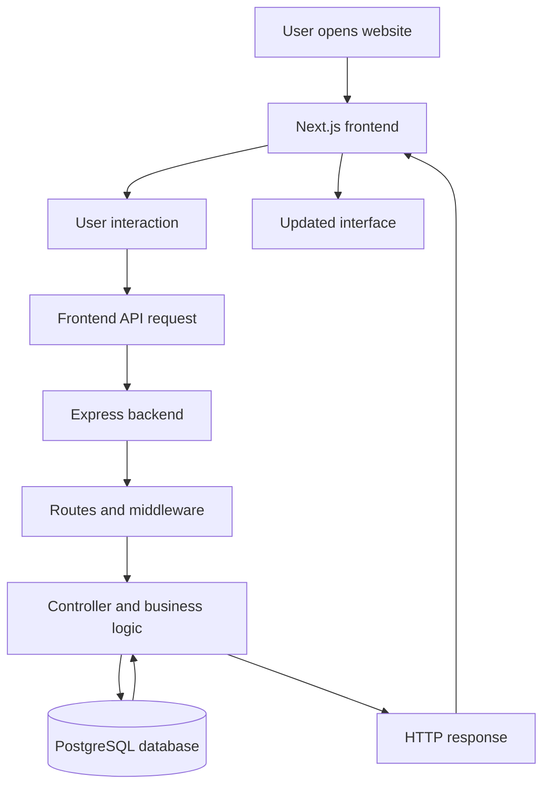

# EthixWeb — Fullstack Digital Operations & Web Development Platform

EthixWeb is a full-stack web platform that combines modern web engineering, digital operations, and AI-driven automation with a distinctive visual identity inspired by the real India.

The project brings together contemporary web design, cinematic storytelling, interactive animations, and a modular backend architecture to create a digital experience that feels modern, immersive, and authentic.

---

## 1. Project Overview

EthixWeb is designed around two core objectives:

- **Engineering:** Build a scalable web platform with a modern frontend, structured backend APIs, database integration, and interactive user experiences.
- **Design:** Combine contemporary website design with authentic Indian visual storytelling, using cinematic imagery and video that represent India's real landscapes, infrastructure, culture, and evolving identity.

The project explores how modern digital experiences can be built without losing their connection to the real world. Its visual direction combines sophisticated layouts, motion design, interactive components, and a hero section that presents India through authentic visuals rather than relying exclusively on conventional corporate imagery.

The repository is organized as a unified project containing a Next.js frontend and an Express.js backend.

## 2. Design Philosophy: Modern Web Design Meets Real India

A central design decision behind EthixWeb is to combine modern digital aesthetics with the visual identity of contemporary India.

### Modern digital experience

The website incorporates modern web design principles, including:

- Cinematic hero presentations and immersive media.
- Clean typography, structured layouts, and responsive spacing.
- Interactive sections and motion-based storytelling.
- Scroll-driven animations and dynamic transitions.
- Three-dimensional presentations and interactive visual elements.
- Responsive navigation and reusable UI components.

### Authentic Indian visual storytelling

The hero section is intended to show real India through authentic visual material rather than generic corporate stock imagery.

Its visual direction emphasizes:

- Real Indian landscapes and geographical diversity.
- India's infrastructure, architecture, cities, and transportation networks.
- The people, places, and environments that shape contemporary India.
- A cinematic presentation that connects India's real-world identity with a modern digital interface.

The objective is not to make the entire website traditionally themed or to use Indian motifs as decoration. Instead, the design places authentic Indian imagery within a contemporary web experience.

**The result is a combination of modern web aesthetics and real-world Indian visual storytelling.** The technology provides the interactive experience, while the imagery gives the website its distinctive identity.

## 3. Technology Stack

| Layer | Technology | Purpose |
|---|---|---|
| Frontend framework | Next.js 16 | Page routing, rendering, and application structure |
| UI library | React 19 | Component-based interface development |
| Programming language | TypeScript | Type safety and maintainable code |
| Styling | Tailwind CSS | Responsive layouts and UI styling |
| Animation | GSAP and ScrollTrigger | Scroll-driven animation and pinned sections |
| Motion | Framer Motion | Component transitions and interactive motion |
| Smooth scrolling | Lenis | Smooth scrolling interactions |
| Graphics | WebGL and related browser graphics APIs | Interactive visual presentations |
| Backend runtime | Node.js | Server-side JavaScript execution |
| Backend framework | Express.js | HTTP server and API routing |
| Database | PostgreSQL | Relational data storage |
| Database hosting | Neon PostgreSQL | Hosted PostgreSQL infrastructure |
| Database client | `pg` | PostgreSQL connectivity |
| Authentication | JSON Web Tokens (JWT) | Token-based authentication |
| Password security | `bcryptjs` | Password hashing |
| Configuration | `dotenv` | Environment variable loading |
| Cross-origin requests | CORS | Configurable cross-origin access |
| Frontend deployment | Vercel | Hosting option for the Next.js application |
| Backend deployment | Render or Railway | Hosting options for the Express application |

The table describes the stated project stack. Verify the installed dependencies and actual deployment configuration in the repository before treating every technology or hosting option as actively configured.

## 4. Project Architecture

```text
hero/
├── README.md
│
├── backend/
│   ├── config/
│   ├── controllers/
│   ├── middleware/
│   ├── routes/
│   ├── scripts/
│   ├── package.json
│   └── server.js
│
└── hero-app/
    ├── public/
    ├── src/
    │   ├── app/
    │   │   ├── page.tsx
    │   │   ├── about/
    │   │   ├── services/
    │   │   ├── contact/
    │   │   ├── admin/
    │   │   ├── layout.tsx
    │   │   └── globals.css
    │   │
    │   ├── components/
    │   │   ├── Navbar.tsx
    │   │   ├── Footer.tsx
    │   │   ├── AboutUS.tsx
    │   │   ├── HeroApp.tsx
    │   │   ├── Paragraph.tsx
    │   │   └── ui/
    │   │
    │   └── constants/
    │
    ├── package.json
    └── next.config.ts
```

This is a high-level representation based on the supplied project structure. The actual repository may contain additional files and directories.

### Frontend — `hero-app/`

The frontend is responsible for rendering the website, handling navigation, presenting content, executing animations, and managing user interactions.

Its main areas include:

- `src/app/` — application pages and route definitions.
- `src/components/` — reusable UI components and visual sections.
- `src/components/ui/` — specialized interactive components and animations.
- `public/` — static assets such as images, videos, and audio.
- `src/app/globals.css` — global styling and responsive rules.
- `next.config.ts` — Next.js configuration.

### Backend — `backend/`

The backend is responsible for processing HTTP requests, executing application logic, validating incoming data, managing authentication, and interacting with PostgreSQL where required.

Its principal areas include:

- `config/` — database and service configuration.
- `controllers/` — request handling and application logic.
- `middleware/` — authentication, request processing, and error handling.
- `routes/` — API endpoint definitions.
- `scripts/` — database setup, migration, or seed utilities.
- `server.js` — backend server entry point.

The exact responsibilities and available functionality of these modules should be confirmed against their implementations.

## 5. Application Workflow

The general request lifecycle is as follows:



This diagram represents the intended full-stack request flow. Database operations occur only for features that actually use the database; not every frontend interaction necessarily requires a backend request.

### Typical request sequence

1. The user opens a page in the browser.
2. Next.js renders the appropriate page and its components.
3. The user submits a form or performs an action that requires server-side processing.
4. The frontend sends an HTTP request to the configured backend API.
5. Express processes the request through its routes and middleware.
6. The relevant controller validates the input and executes the required application logic.
7. If necessary, the backend reads from or writes to PostgreSQL.
8. The backend returns an HTTP response.
9. The frontend handles the result and updates the interface.

## 6. Frontend Experience and Interactive Components

EthixWeb uses a component-based frontend architecture to combine conventional website navigation with immersive visual sections.

The supplied component inventory includes:

- `HeroApp.tsx` — the cinematic homepage hero and associated presentation.
- `AboutUS.tsx` — the animated company narrative section.
- `Paragraph.tsx` — a structured heading and typography component.
- `Navbar.tsx` — shared website navigation.
- `Footer.tsx` — shared footer.
- `WorksWheelDemo` — an interactive portfolio presentation.
- `GlobalOperationsNetwork` — the MacBook-related visual presentation.
- `PaperCurlDemo` — a paper-turning visual effect, if present under the documented component path.

The application also uses GSAP and ScrollTrigger for scroll-based motion, with Framer Motion and Lenis supporting other interactive experiences.

These effects should complement the content rather than obstruct navigation, readability, or responsive behavior.

## 7. Backend and API Integration

The Express backend provides the server-side application layer.

The documented architecture includes routes associated with leads and administrative functionality. Authentication is described as JWT-based, with `bcryptjs` used for password hashing.

The intended responsibilities are:

- Accept HTTP requests from the frontend.
- Validate request data.
- Execute business logic.
- Enforce authentication and authorization where required.
- Interact with PostgreSQL where applicable.
- Return appropriate success or error responses.

### Database

PostgreSQL is the relational database technology specified for the project, with Neon listed as the hosted database option.

The backend uses the `pg` package to establish database connectivity. The connection string should be supplied through an environment variable rather than embedded in application code.

Actual tables, migrations, seed scripts, endpoint paths, and authentication rules must be documented from the corresponding backend source files.

## 8. Prerequisites

The supplied setup configuration specifies the following prerequisites:

- Node.js 18 or later.
- npm 9 or later.
- A PostgreSQL database connection URI, using Neon or a local PostgreSQL instance.
- Any additional environment variables or external service credentials required by the implementation.

Use a Node.js version supported by the installed Next.js release and the project's package configuration. Confirm compatibility before choosing a version for a fresh installation.

## 9. Installation and Setup

### Step 1: Set up the backend

Open a terminal at the repository root:

```bash
cd backend
npm install
```

Create a `.env` file inside `backend/`:

```env
PORT=5000
NODE_ENV=development
DATABASE_URL=your_postgresql_connection_string
JWT_SECRET=replace_with_a_secure_random_secret
CLIENT_URL=http://localhost:3000
```

Replace the placeholders with valid local configuration. Never commit actual credentials or production secrets to the repository.

If the backend package defines a migration script, run it using the exact script name from `backend/package.json`. The supplied setup refers to `npm run migrate`, which must be verified before use.

Start the development server using the script defined in the backend package:

```bash
npm run dev
```

The expected local backend address is `http://localhost:5000`, provided that the server is configured to listen on port 5000.

### Step 2: Set up the frontend

Open a second terminal at the repository root:

```bash
cd hero-app
npm install
```

Create a `.env.local` file inside `hero-app/`:

```env
NEXT_PUBLIC_API_URL=http://localhost:5000
```

This value must match the API base URL expected by the frontend implementation.

Start the Next.js development server:

```bash
npm run dev
```

If the configured development port is 3000, open:

`http://localhost:3000`

### Step 3: Verify integration

1. Confirm that the backend starts without database or configuration errors.
2. Confirm that the frontend loads in the browser.
3. Open the browser developer tools and inspect the Console and Network tabs.
4. Trigger a frontend feature that uses the backend.
5. Confirm that the request reaches the correct endpoint and returns the expected response.
6. Verify that error states are handled appropriately.

## 10. Administration and Authentication

The supplied project structure includes an administrative page at `/admin`.

Local development URL:

`http://localhost:3000/admin`

The documented authentication design includes:

- Password hashing using `bcryptjs`.
- JWT-based authentication.
- Protected backend endpoints.
- Role-based authorization, where implemented.

The exact access rules must be verified against the authentication middleware and route configuration.

For security, do not publish working administrator credentials in the repository README. Use a designated test account configured through the project's approved setup or seed process, and distribute demo credentials separately when necessary.

## 11. Responsive Design

The design targets a range of screen sizes:

| Device category | Target width |
|---|---:|
| Small mobile | 320–375px |
| Large mobile | 390–430px |
| Tablet | 768–1024px |
| Desktop | 1440–1920px and wider |

Responsive behavior includes flexible layouts, fluid typography, adaptive spacing, mobile navigation, and appropriately sized media.

Animation-heavy sections require particular attention because fixed dimensions, pinned scrolling, and complex transforms can behave differently on smaller screens.

The responsive implementation should preserve the visual identity of the website while maintaining readable content, usable controls, and natural scrolling across devices.

## 12. Build and Quality Checks

Run the frontend production build:

```bash
cd hero-app
npm run build
```

The build should complete without compilation or TypeScript errors.

To identify the exact commands available for linting and automated testing, inspect the scripts in each package manifest:

```bash
cd hero-app
npm run
```

```bash
cd ../backend
npm run
```

Run the available test and quality-check scripts as appropriate. A successful production build verifies compilation, but it does not by itself prove that backend integration, authentication, database operations, or browser interactions work correctly.

## 13. Manual Testing Checklist

### Frontend

- [ ] Homepage renders correctly.
- [ ] About, Services, and Contact pages load.
- [ ] Navigation links work correctly.
- [ ] Hero media loads without unintended distortion.
- [ ] Interactive animations behave correctly.
- [ ] Mobile navigation is usable.
- [ ] No unintended horizontal scrolling occurs.
- [ ] Forms display validation feedback where implemented.

### Backend

- [ ] Server starts with the required environment configuration.
- [ ] Database connection succeeds when the database is required.
- [ ] Implemented API endpoints return appropriate responses.
- [ ] Invalid inputs are handled appropriately.
- [ ] Protected endpoints enforce their configured authentication rules.

### Full-stack integration

- [ ] Frontend requests reach the correct backend endpoints.
- [ ] Successful responses are reflected in the interface.
- [ ] API errors are handled appropriately.
- [ ] Database-backed features behave as expected.
- [ ] Responsive behavior is checked at representative viewport widths.

Only mark checks as completed after actually running them.

## 14. Deployment Architecture

The supplied deployment plan identifies the following hosting options:

| Component | Hosting option |
|---|---|
| Next.js frontend | Vercel |
| Express backend | Render or Railway |
| PostgreSQL database | Neon |

Deployment requires environment variables to be configured separately for each environment.

The frontend's API base URL must point to the deployed backend, and the backend's CORS configuration must permit the deployed frontend origin. Database connection details and JWT secrets must be configured securely in the hosting provider's environment settings.

These are deployment options, not confirmation that the application has already been deployed to these services.

## 15. Known Limitations and Verification

The project should be evaluated against its actual implementation rather than its intended architecture.

Before a demonstration, verify:

- Which API endpoints are implemented and operational.
- Which database migrations and seed scripts are available.
- Whether the administrative authentication flow works end to end.
- Whether the frontend and backend use matching API configuration.
- Which automated tests exist.
- Whether all documented routes and interactive components are functional.

Any incomplete integration or unverified behavior should be disclosed during evaluation.

## 16. Project Summary

EthixWeb brings together full-stack web engineering and a visual approach that connects modern digital design with authentic Indian imagery.

The frontend focuses on responsive layouts, cinematic media, interactive motion, and component-based development. The backend provides the API and data-processing layer, with PostgreSQL and JWT-based authentication forming part of the specified architecture.

The project's defining visual direction is the combination of a contemporary web experience with a hero presentation that depicts the real India. Rather than separating technology from visual storytelling, EthixWeb uses both to create a cohesive digital platform.

---

**Project:** EthixWeb  
**Architecture:** Next.js frontend with Express.js backend  
**Database:** PostgreSQL  
**Primary focus:** Web engineering, interactive design, digital operations, and authentic Indian visual storytelling


## Demo Access and Tester Setup

For testing and project evaluation, use the following steps to access the demo:

1. Start the frontend and backend using the setup instructions in this README.
2. Open the website at `http://localhost:3000`.
3. Navigate to the **Demo** section using the website navbar.
4. On the demo login screen, use the following tester account for the initial setup:

   - **Email:** `tester123@gmail.com`
   - **Password:** `tester123455`

5. Submit the login form and verify that the demo dashboard opens successfully.
6. Test the available dashboard features and verify that protected functionality behaves as expected.

**Testing note:** These credentials are intended for the project's initial testing setup. Confirm that the account exists and that the login flow is configured correctly before the evaluation. Do not use this account for production data or sensitive information.